<picture><source media="(prefers-color-scheme: dark)" srcset="assets/hero-dark.svg"></picture>

<picture><source media="(prefers-color-scheme: dark)" srcset="assets/about-dark.svg"></picture>

<picture><source media="(prefers-color-scheme: dark)" srcset="assets/stack-dark.svg"></picture>

<a href="https://github.com/pernicekcute/SwiftyApp"><picture><source media="(prefers-color-scheme: dark)" srcset="assets/project-swiftyapp-dark.svg"></picture></a>&nbsp;<a href="https://github.com/pernicekcute/Cowstalt"><picture><source media="(prefers-color-scheme: dark)" srcset="assets/project-cowstalt-dark.svg"></picture></a>

<a href="https://github.com/pernicekcute/RobloxGameFiles"><picture><source media="(prefers-color-scheme: dark)" srcset="assets/project-robloxgamefiles-dark.svg"></picture></a>&nbsp;<a href="https://github.com/pernicekcute/HowToGetAchivements"><picture><source media="(prefers-color-scheme: dark)" srcset="assets/project-howtogetachivements-dark.svg"></picture></a>

<picture><source media="(prefers-color-scheme: dark)" srcset="assets/stats-dark.svg"></picture>

<picture><source media="(prefers-color-scheme: dark)" srcset="assets/streak-dark.svg"></picture>

<picture><source media="(prefers-color-scheme: dark)" srcset="assets/wave-dark.svg"></picture>

<a href="rkyroaddd3.rf.gd"><picture><source media="(prefers-color-scheme: dark)" srcset="assets/button-1-dark.svg"></picture></a>

<a href="https://metawka.github.io/expressive-profile/?from=pernicekcute"><picture><source media="(prefers-color-scheme: dark)" srcset="assets/credit-dark.svg"></picture></a>

